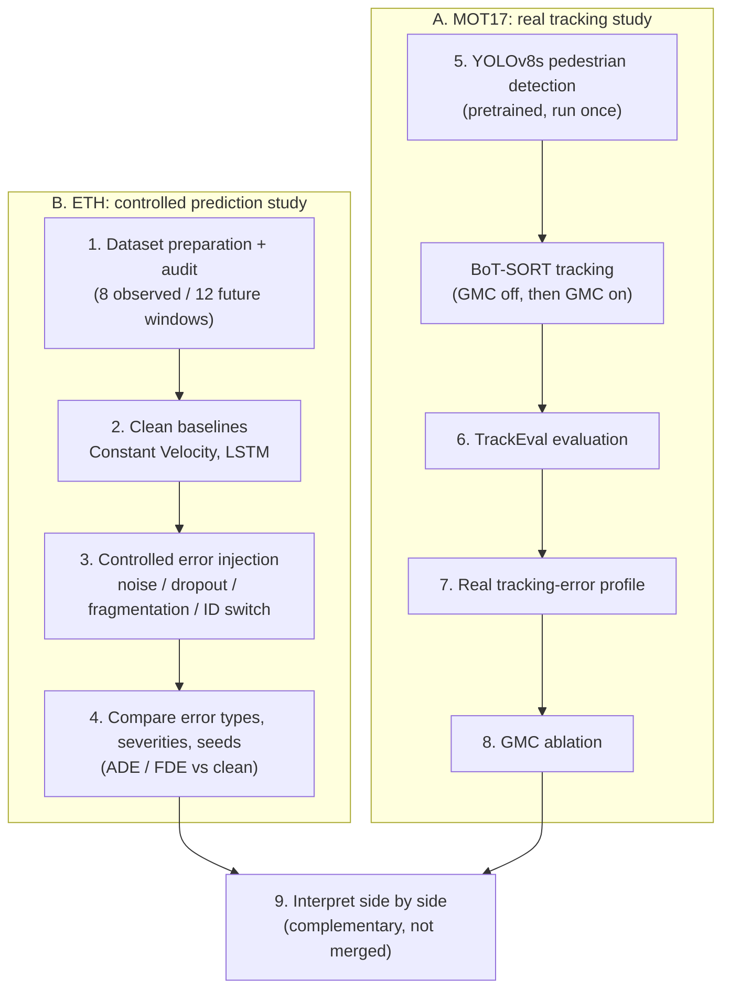
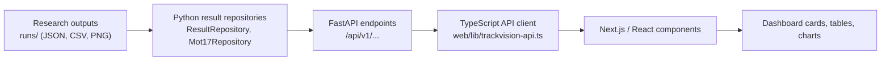

# TrackVision

**Deep Learning-Based Multi-Object Tracking and Future Trajectory Prediction in Dynamic Environments**

TrackVision studies how errors made by a pedestrian detector and tracker propagate into downstream
trajectory prediction. It combines two complementary studies, a read-only results API and a research
dashboard.

> **Scope.** The goal is to *study the effect of tracking errors on pedestrian trajectory prediction*,
> not to claim a new state-of-the-art tracker. No MOT17 trajectory-prediction experiment has been run
> (see [Limitations](#11-results-and-limitations)).

## Quick start

| | |
|---|---|
| **What it does** | Measures real detector + tracker errors on MOT17 and, separately, measures how four controlled tracking errors degrade Constant Velocity and LSTM prediction on ETH. A dashboard shows the saved results. |
| **MOT17** (real tracking) | Pretrained YOLOv8s + BoT-SORT (with and without Global Motion Compensation), scored with TrackEval on 7 training sequences. |
| **ETH** (prediction) | 8-observed / 12-predicted pedestrian windows, Constant Velocity and LSTM baselines, four injected error types, ADE/FDE. |
| **Technologies** | Python, NumPy, PyTorch, Ultralytics, TrackEval, FastAPI, Uvicorn, Pydantic, Next.js, React, TypeScript, Tailwind CSS, Recharts |
| **Detailed method** | [Section 3](#3-research-methodology) onward, plus [Project_Methodology.md](Project_Methodology.md) (the original *proposed* plan) |

Run the dashboard (two terminals, from the repository root; details in [Section 9](#9-setup-and-running)):

```powershell
# Terminal 1 - results API  ->  http://localhost:8000  (docs: http://localhost:8000/docs)
python -m uvicorn trackvision.api.app:app --app-dir src --reload

# Terminal 2 - dashboard    ->  http://localhost:3000
cd web
npm install
npm run dev
```

The API needs `fastapi`, `uvicorn` and `pydantic`, and the saved results under `runs/`. The dashboard does
**not** rerun YOLO, tracking or training.

## Contents

1. [Introduction](#1-introduction)
2. [The two studies and how they relate](#2-the-two-studies-and-how-they-relate)
3. [Research methodology](#3-research-methodology)
4. [ETH prediction pipeline](#4-eth-prediction-pipeline)
5. [MOT17 real tracking pipeline](#5-mot17-real-tracking-pipeline)
6. [MOT17 evaluation metrics and results](#6-mot17-evaluation-metrics-and-results)
7. [Software architecture](#7-software-architecture)
8. [Dependencies](#8-dependencies)
9. [Setup and running](#9-setup-and-running)
10. [Repository structure](#10-repository-structure)
11. [Results and limitations](#11-results-and-limitations)
12. [Notes for maintainers](#12-notes-for-maintainers)

---

## 1. Introduction

Multi-object tracking (MOT) turns per-frame detections into per-pedestrian *trajectories*. Those
trajectories are the input of downstream components such as trajectory predictors. In dynamic
environments (moving cameras, crowds, occlusion) trackers make mistakes:

- the detector **misses** a pedestrian or places the box imprecisely (missing and noisy observations);
- the tracker **loses** a pedestrian and later restarts them under a new ID (fragmentation);
- the tracker **swaps** identities between nearby pedestrians (identity switch).

Each mistake changes the observed history that a predictor sees: coordinates are perturbed, points are
absent, a history is cut short, or it contains another person's positions. A predictor that was trained on
clean histories may then predict worse. TrackVision investigates this in two ways: by **measuring** what errors a
real tracker makes (MOT17), and by **injecting** controlled errors of the same four types into clean
trajectories and measuring prediction degradation (ETH).

## 2. The two studies and how they relate

| | A. MOT17 - real tracking evaluation | B. ETH - prediction and controlled error injection |
|---|---|---|
| Question | What errors does a real detector + tracker make? | How much does each error type degrade prediction? |
| Data | 7 MOT17 *training* sequences, image pixels | Social-STGCNN ETH/UCY split tables (`train`/`val`/`test`), raw dataset coordinates |
| Models | Pretrained COCO YOLOv8s (no training) + BoT-SORT, GMC on/off | Constant Velocity, 2-layer LSTM (trained on ETH train split) |
| Evaluation | TrackEval: HOTA, DetA, AssA, LocA, MOTA, IDF1, ... | ADE / FDE against clean baseline |
| Status | Implemented, saved under `runs/mot17_tracking_analysis/` | Implemented, saved under `runs/prediction/` and `runs/error_injection/` |

**How they are used together.** MOT17 supplies evidence about the *kinds and rough magnitudes* of real
tracker errors. ETH supplies a *controlled* setting where each error is injected alone, at known severity,
so its effect on prediction can be isolated.

**Important distinctions**

- MOT17 and ETH are **not merged**. Their coordinate systems differ, and MOT17 image pixels are not metres.
- The ETH severity levels are **exploratory**. They are *not* calibrated to MOT17 or to any measured tracker error distribution.
- This work does **not** claim that BoT-SORT errors *caused* a measured ADE/FDE change on MOT17. The two studies are complementary evidence only.
- **MOT17-specific trajectory-prediction training or evaluation is not implemented.** The MOT17 trajectory CSVs exist as pixel-space files for a possible future stage and must not be fed to the ETH-trained LSTM.

## 3. Research methodology



| # | Stage | Where |
|---|---|---|
| 1 | ETH dataset preparation and auditing | `io/eth.py`, `io/eth_audit.py`, `runs/audits/eth/` |
| 2 | Clean CV and LSTM baselines | `prediction/constant_velocity.py`, `lstm.py`, `experiment.py`, `runs/prediction/eth/` |
| 3 | Controlled tracking-error injection | `prediction/{localization_noise,detection_dropout,track_fragmentation,identity_switch}.py` |
| 4 | Comparison across error types, severities, seeds | `runs/error_injection/` |
| 5 | MOT17 pedestrian detection and tracking | `tracking/mot17/{detection,tracker,pipeline}.py` |
| 6 | TrackEval real tracking evaluation | `tracking/mot17/evaluation.py` |
| 7 | Real tracking-error profile | `tracking/mot17/error_profile.py` |
| 8 | GMC ablation | `tracking/mot17/gmc_pipeline.py`, `runs/mot17_tracking_analysis/gmc_fixed/` |
| 9 | Interpretation | Dashboard (separate, labelled studies) |

## 4. ETH prediction pipeline

### 4.1 Data preparation

- **Source.** Social-STGCNN ETH/UCY split tables expected at `data/eth/Social-STGCNN/datasets/eth/{train,val,test}/`. The data are not committed.
- **Row format.** Whitespace-separated `frame_id ped_id x y`. Coordinates are kept unchanged. Physical units are **unverified**, so all distances are reported in "raw dataset coordinate units".
- **Validation.** `validate_social_stgcnn_file` rejects non-numeric or non-finite values, negative or non-integer IDs, duplicate or conflicting frame/pedestrian pairs and out-of-order frames. Invalid files raise an error rather than being partly loaded.
- **Scenes.** Train: HOTEL, ZARA1, ZARA2, ZARA3, STUDENTS001, UNIV, UNI_EXAMPLES. Validation: the same seven scenes (later time ranges). Test: ETH only.
- **`frame_step = 10`.** A window is built only from rows that are **exactly 10 frame-ID units apart**. Sampled observations are never interpolated, gaps are never bridged, and different pedestrians, files and splits are never joined.
- **Why no interpolation or track joining.** The Social-STGCNN tables do not document how frame IDs map to seconds. Interpolating or stitching discontinuous tracks would invent positions or merge distinct pedestrians. Discontinuous tracks therefore simply produce fewer windows.
- **Windows.** Each window has 8 observed and 12 future positions (stride 1), i.e. 20 consecutive sampled positions of one pedestrian.
- **Audit result** (`runs/audits/eth/dataset-audit.json`, no issues recorded):

| Split | Files | Observations | Candidate windows |
|---|---:|---:|---:|
| train | 7 | 56,842 | 30,307 |
| val | 7 | 12,094 | 5,422 |
| test | 1 (ETH) | 5,492 | 364 |

- **Leakage control.** Train, validation and test are separate files. For pedestrian IDs shared between train and validation within a scene, the audit records that validation starts after train ends, with no identical observation rows. The test split is opened only by the final frozen-checkpoint evaluation; no error-injection experiment opens it.

### 4.2 Constant Velocity (baseline)

From the last two observed positions $p_7, p_8$ of the eight, the per-sample velocity is
$v = p_8 - p_7$ and the prediction is

$$\hat p_{8+k} = p_8 + k\,v,\qquad k = 1,\dots,12 .$$

(Implemented in `constant_velocity.py`. The velocity is per *sampled observation*, not per second.) It has no
parameters and no training, so it is a simple reference point for how much a learned model adds.

### 4.3 LSTM

| Item | Value (selected model) |
|---|---|
| Input | `(batch, 8, 2)`: 8 observed (x, y) positions, normalized |
| Output | `(batch, 12, 2)`: 12 future (x, y) positions |
| Architecture | Batch-first `nn.LSTM`, **2 layers**, hidden size **64**, dropout 0.0; the final time-step output goes through one `nn.Linear(64, 24)` reshaped to 12x2 (a direct decoder, no autoregressive feedback) |
| Normalization | Per-coordinate mean/std fitted on unique **train** rows (mean 7.279, 6.000; scale 4.496, 4.125); predictions are inverse-transformed to raw units |
| Loss | MSE on normalized absolute coordinates |
| Optimizer | Adam, learning rate 1e-3 |
| Scheduler | `ReduceLROnPlateau` (factor 0.5, patience 4) on validation ADE |
| Batch size | 256 |
| Epochs | max 100, early-stopping patience 15 (not triggered; the best epoch was epoch 100) |
| Model selection | Lowest validation per-window ADE; the test split is not used |
| Seed / device | 42 / CPU |
| Checkpoint | `runs/prediction/eth/lstm-seed42-h64-l2-scheduler/best_lstm.pt` (git-ignored) |

The eight observed coordinates are normalized and fed as a length-8 sequence. The LSTM updates its hidden
state at each step; the last output summarizes the history and the linear layer maps it to all 24 future
coordinate values at once, which are then converted back to dataset units. GRU was **not** implemented or evaluated.

Four LSTM runs are saved (`lstm-seed42-h64-l1`, `-l1-epochs100`, `-l1-scheduler`, `-l2-scheduler`) plus a smoke run. All error-injection experiments use the
2-layer scheduler model (validation ADE 0.4381, the lowest of the saved runs).

**Clean baselines**

| Split | Windows | Model | ADE | FDE |
|---|---:|---|---:|---:|
| Validation (7 scenes) | 5,422 | Constant Velocity | 0.4471 | 0.9877 |
| Validation | 5,422 | LSTM | 0.4381 | 0.9317 |
| Test (ETH only, sealed until final evaluation) | 364 | Constant Velocity | 1.0755 | 2.2819 |
| Test | 364 | LSTM | 1.0571 | 2.0896 |

ADE/FDE are Euclidean errors averaged equally over windows (ADE over the 12 steps; FDE at step 12).
The test result is a **limited, single-scene** held-out evaluation and should not be generalised.

### 4.4 Controlled error injection (common design)

All four experiments (`runs/error_injection/<experiment>/`) share this protocol:

- **Validation split only** (5,422 candidate windows); the test split and training data are not accessed.
- **Frozen models.** Constant Velocity and the 2-layer LSTM checkpoint are used unchanged (no retraining on corrupted data).
- **Only observed inputs are corrupted.** Future ground truth is used only for scoring (never corrupted, except that windows can be dropped).
- **Seeds 42, 43, 44.** Results report the mean and population standard deviation over the three seeds; the API/dashboard can also show a single seed.
- **Severities** `low`, `medium`, `high`, defined per experiment below. They are *exploratory relative settings*, not measured tracker-error distributions.
- **Overlapping windows.** Corruption is decided once per underlying observation (keyed by scene, pedestrian, frame), so overlapping windows that share an observation see the same corrupted value.
- **Scoring.** ADE/FDE of the corrupted run versus the clean baseline on the matching windows; per-seed reports hold per-scene and per-timestep detail.

### 4.5 Localization noise

*Meaning.* The detector's boxes are imprecise, so the observed position is offset from the true one.
*Where introduced.* On observed (x, y) only.

Each unique observed position receives independent isotropic Gaussian noise $\mathcal N(0,\sigma^2 I)$. The scale is tied
to the data: $\sigma = m \cdot d$, where $d = 0.3091$ is the median displacement between adjacent exact-cadence **train** observations (55,294 pairs) and
$m$ is 0.10 / 0.25 / 0.50.

| Severity | $m$ | $\sigma$ (dataset units) | Constant Velocity ADE | LSTM ADE (vs clean 0.4381) |
|---|---:|---:|---:|---:|
| low | 0.10 | 0.0309 | 0.6422 | 0.6122 (+39.8%) |
| medium | 0.25 | 0.0773 | 1.1167 | 1.0675 (+143.7%) |
| high | 0.50 | 0.1546 | 2.0251 | 1.9130 (+336.7%) |

Clean Constant Velocity ADE is 0.4471. *Limitations.* Noise is independent per frame; real detector error is correlated in time and with box size/occlusion. Future ground truth is not modified, and no windows are removed.

### 4.6 Detection dropout

*Meaning.* The detector misses a pedestrian in some frames, so an observation is absent. *Where introduced.* Observed positions are removed.

A Bernoulli mask removes each unique observed position independently with rate 10% / 20% / 30%. The
**implemented recovery policy** then fills each gap: linear interpolation between the nearest valid observed positions, and
the nearest valid position for leading/trailing gaps; a window with all eight observed positions missing is *unusable* and excluded (high severity: 0.67 windows per seed on average). The recovered window is then given to the
predictor. Future ground truth is untouched.

| Severity | Rate | Actual missing (unique) | Longest run (mean) | Constant Velocity ADE | LSTM ADE |
|---|---:|---:|---:|---:|---:|
| low | 10% | 10.0% | 4.3 | 0.5765 | 0.5772 (+31.8%) |
| medium | 20% | 20.5% | 6.0 | 0.7232 | 0.7315 (+67.0%) |
| high | 30% | 30.5% | 7.0 | 0.8660 | 0.8805 (about +101%) |

*Limitations.* Dropouts are independent per frame, whereas real misses often come in bursts; the imputation policy shapes the result as much as the dropout itself.

### 4.7 Track fragmentation

*Meaning.* The tracker loses a pedestrian and restarts them with a new ID, cutting one continuous history into two. *Where introduced.* Before window construction.

For each eligible original track, one seed-specific interior interruption is chosen. A run of **1 / 2 / 3** consecutive sampled observations (gap of
20 / 30 / 40 frame-ID units) is **removed from the source track** (no stitching or interpolation), and the track is split into two fragments with a new
synthetic ID. Windows are then rebuilt: a window survives only if its 8 observed positions lie in one fragment. 251 tracks are fragmented per seed.
Surviving windows keep their original observed inputs, and original ground-truth futures may span the removed samples.

Consequently the **primary effect is lost windows, not worse predictions on the surviving windows**:

| Severity | Retained windows (of 5,422) | Retention | Constant Velocity ADE | LSTM ADE |
|---|---:|---:|---:|---:|
| low | 4,129 | 76.2% | 0.4205 | 0.4137 |
| medium | 4,002 | 73.8% | 0.4165 | 0.4107 |
| high | 3,889 | 71.7% | 0.4127 | 0.4080 |

The ADE on retained windows is compared against the clean ADE on the *same* retained windows, so the matched degradation is 0.0 by design (the lower absolute ADE
simply reflects which windows survive). *Limitation.* This experiment measures availability loss; it does not model how a predictor would behave if it were fed a short, restarted history.

### 4.8 Identity switches

*Meaning.* The tracker swaps IDs between two nearby pedestrians, so a history contains a different person's positions. *Where introduced.* Observed positions.

At most one pair/event per scene (no pedestrian reused) is chosen with a seeded, inverse-distance-rank-weighted choice that favours pedestrians that are spatially close. For a
temporary interval of **1 / 2 / 3 timestamps** (severity low / medium / high), the timestamp-aligned observed (x, y) positions of the two pedestrians are **exchanged**, then each
returns to its own. The *future ground truth is not swapped*, so the predictor sees partly the wrong person's past but is scored against the true future. The pair and start are shared across severities; 7 events occur per seed.

| Severity | Affected windows (mean) | Constant Velocity ADE | LSTM ADE |
|---|---:|---:|---:|
| low | 73 (1.35%) | 0.5019 | 0.4738 (+8.2%) |
| medium | 81 (1.49%) | 0.5045 | 0.4824 (+10.1%) |
| high | 88 (1.62%) | 0.5054 | 0.4844 (+10.6%) |

*Limitations.* This is a **simplified, temporary symmetric position swap**, not a simulation of real association failures. The overall ADE change is diluted because fewer than 2% of windows are affected.

### 4.9 Summary of ETH findings

- LSTM improves slightly on Constant Velocity in clean validation ADE (0.438 vs 0.447) and FDE (0.932 vs 0.988).
- Localization noise and detection dropout cause large, monotonic ADE increases; the LSTM is not more robust in absolute terms for dropout.
- Fragmentation reduces the number of usable windows by 24-28% rather than degrading the survivors.
- Identity switches affect few windows but raise ADE by about 5-13% overall.
- All severities are exploratory and uncalibrated.

## 5. MOT17 real tracking pipeline

### 5.1 Dataset

- **Location.** `data/MOT17/train/` (and `test/`); the default dataset root is `data/MOT17`. Not committed.
- **Seven underlying videos.** MOT17 has 7 training sequences (02, 04, 05, 09, 10, 11, 13). The folders `-DPM`, `-FRCNN`, `-SDP` of each sequence contain the **same video and ground truth** and differ only in the public detections, so the 21 folders are **not** 21 independent videos. The `FRCNN` folder is the canonical image/ground-truth source; the public detections are not used.
- **Ground truth.** The training-set ground truth is used for local evaluation (112,297 evaluated ground-truth boxes, 546 identities). There are **no standard test-set metrics**, because MOT17 test ground truth is not public.

| Sequence | Frames | FPS | Resolution |
|---|---:|---:|---|
| MOT17-02 | 600 | 30 | 1920x1080 |
| MOT17-04 | 1050 | 30 | 1920x1080 |
| MOT17-05 | 837 | 14 | 640x480 |
| MOT17-09 | 525 | 30 | 1920x1080 |
| MOT17-10 | 654 | 30 | 1920x1080 |
| MOT17-11 | 900 | 30 | 1920x1080 |
| MOT17-13 | 750 | 25 | 1920x1080 |

(Verified against `runs/mot17_tracking_analysis/trajectories/sequences.json` and `config/dataset_inventory.json`; 5,316 frames in total.)
MOT17-05 is low resolution. The saved GMC report treats 02, 04 and 09 as static-looking cameras and 05, 10, 11 and 13 as moving cameras.

### 5.2 YOLOv8s detection

No model was trained or fine-tuned. Weights are the pretrained COCO `yolov8s.pt` (expected at `runs/mot17_tracking_analysis/weights/yolov8s.pt`, git-ignored).

| Setting | Value |
|---|---|
| Class | COCO `person` (unique class ID looked up from the model's names) |
| Image size | 1280 |
| Confidence threshold | 0.05 (deliberately below the tracker's low threshold so detections can serve later analysis) |
| NMS IoU threshold | 0.7 |
| Max detections / frame | 1000 |
| Device | CPU |
| Test-time augmentation | off |

Detections are saved once per sequence as MOTChallenge-style rows `frame, -1, left, top, width, height, confidence` (1-based pixel coordinates, original frame numbering) in
`runs/mot17_tracking_analysis/detections/` (178,500 detections in total). **They are computed once and reused**, so every tracker variant sees identical detections: differences between runs
then come only from the tracker, and CPU YOLO inference (about 1.1-1.7 fps) is not repeated. Detection resumes after interruption.

### 5.3 BoT-SORT tracking

TrackVision runs the **Ultralytics `BOTSORT` implementation** over the saved detections, with a fresh tracker per sequence. The settings are the Ultralytics `botsort.yaml` defaults and were **not tuned** on MOT17 ground truth:

| Parameter | Value | Role |
|---|---:|---|
| `track_high_thresh` | 0.25 | detections at or above this go to the first association |
| `track_low_thresh` | 0.1 | detections between 0.1 and 0.25 are the "low-confidence" set |
| `new_track_thresh` | 0.25 | minimum score to start a new track |
| `track_buffer` | 30 | frames a lost track is kept before removal |
| `match_thresh` | 0.8 | association distance gate (1 - IoU after score fusion) |
| `fuse_score` | true | fuse detection confidence into the IoU cost |
| `gmc_method` | `sparseOptFlow` | camera-motion compensation (see 5.4) |
| `with_reid` | false | **appearance/ReID is disabled** |
| `proximity_thresh`, `appearance_thresh` | 0.5, 0.8 | only used with ReID, so inert here |

**Algorithm per frame**

1. Receive the saved YOLO pedestrian detections.
2. Split them into high-confidence ($\ge 0.25$) and low-confidence (0.1 to 0.25) sets.
3. Predict each existing track's next box with a **Kalman filter** (constant-velocity motion model on the box state).
4. Apply **camera-motion compensation**: warp the predicted boxes by the estimated frame-to-frame transform (GMC).
5. **Associate** high-confidence detections with predicted tracks. The cost is IoU distance fused with detection score and solved by linear assignment (Hungarian-style), gated by `match_thresh`.
6. Use the **low-confidence** detections to try to recover tracks left unmatched (a second association, IoU gate 0.5). Remaining high-confidence detections can match unconfirmed tracks.
7. **Manage track lifecycle**: new detections that remain unmatched and have score at least `new_track_thresh` start tentative tracks; matched tracks are confirmed; unmatched tracks become *lost* and are removed after `track_buffer` frames.
8. **Assign or retain IDs**: a recovered track keeps its ID; a new track gets a new ID. Output boxes are Kalman-filtered estimates.
9. Write per-frame rows `frame, id, left, top, width, height, score`.

Key ideas: IoU (box overlap) measures geometric agreement; detection confidence decides which detections may start or extend tracks; track ID continuity depends on
association alone because ReID is off. **ByteTrack was considered in the original plan but was not run in this project.**

### 5.4 Global Motion Compensation (GMC)

When the camera moves, *every* pedestrian's apparent position shifts even if they stand still, so a Kalman prediction no longer lands on the pedestrian in the next frame. GMC estimates that camera
motion and corrects the predicted boxes before association.

With `sparseOptFlow`: corner features are detected in the previous frame, tracked into the current frame with sparse (Lucas-Kanade) optical flow, and a robust 2x3 affine **warp matrix** is estimated from the matched points. That warp maps previous-frame
pixels to current-frame pixels and is applied to the predicted track locations. The first frame of each sequence has no predecessor, so its warp is the **identity** (7 such warps in total, one per sequence).

> **Implementation note (adapter bug and fix).** The first full run used an adapter class (`DetectionFrame`) that lacked the `xyxy` attribute that GMC reads. Ultralytics silently caught the error and fell back to an identity warp, so **GMC failed on all 5,316 frames** even though `sparseOptFlow` was configured (documented in `runs/mot17_tracking_analysis/reports/post_run_research_audit.md`). The adapter now supplies the expected `xyxy` representation. `RecordingGMC`/`GMCRecorder` in `tracker.py` record every warp and raise `GMCPipelineFailure` on any exception, non-finite warp, or a run of identity warps after frame 1, and a unit test reproduces the original defect.
>
> The original run is **retained as the labelled `BoT-SORT_no_GMC` ablation baseline**. The corrected run (`BoT-SORT_GMC_enabled`, under `runs/mot17_tracking_analysis/gmc_fixed/`) is the **primary result**: it recorded **5,316 successful GMC calls and 0 failures** (5,309 estimated warps + 7 first-frame identities). With GMC explicitly off, the corrected code reproduced the archived tracker files byte for byte, which attributes the metric differences to GMC.

**Caveat.** The exported tracker boxes and trajectory CSVs are in raw image pixels. They are **not** globally stabilised and are **not** world coordinates. Saved warps allow window-length compensation, but accumulating them across a whole sequence drifts badly.

## 6. MOT17 evaluation metrics and results

Evaluation uses [TrackEval](https://github.com/JonathonLuiten/TrackEval) (`MotChallenge2DBox`, class pedestrian, IoU 0.5 for CLEAR/identity metrics, MOT17 preprocessing) at the pinned commit `12c8791b303e0a0b50f753af204249e622d0281a`. As a sanity check, ground truth scored as tracker output gives 100% HOTA, MOTA and IDF1.

### 6.1 Metric definitions

| Metric | Definition | Reading it |
|---|---|---|
| **IoU** | $\frac{\lvert A\cap B\rvert}{\lvert A\cup B\rvert}$ of two boxes | 1 = identical boxes; a match needs IoU at or above a threshold (0.5 for CLEAR/identity metrics) |
| **TP / FP / FN** | matched tracker boxes / unmatched tracker boxes / unmatched ground-truth boxes | more TP and fewer FP/FN is better |
| **Precision, Recall** | $TP/(TP+FP)$, $TP/(TP+FN)$ | how many outputs are right / how many pedestrians are found |
| **DetA** | detection accuracy, $\frac{TP}{TP+FN+FP}$ (HOTA family, averaged over IoU 0.05 to 0.95) | detector-side quality |
| **AssA** | association accuracy: for matched detections, how consistently tracker IDs align with ground-truth IDs | identity-consistency quality |
| **HOTA** | $\sqrt{\mathrm{DetA}\cdot \mathrm{AssA}}$, balanced detection and association | single balanced score; high = good on both |
| **LocA** | mean IoU of matched boxes, averaged over thresholds | box localization quality (matches only) |
| **MOTA** | $1-\frac{FN+FP+IDSW}{GT}$ | dominated by FN/FP; weak penalty for identity errors; can be negative |
| **IDF1** | $\frac{2\,IDTP}{2\,IDTP+IDFP+IDFN}$ | share of boxes carried by the correct *long-term* identity |
| **ID switches (IDSW)** | times a ground-truth pedestrian's matched tracker ID changes | lower is better |
| **Fragmentation (Frag)** | times a tracked ground-truth trajectory is interrupted and later resumed | lower is better, but it can rise when more pedestrians get matched |

### 6.2 Primary result: GMC enabled (combined, 7 sequences)

Pooled TrackEval `COMBINED_SEQ` row (underlying counts pooled, not an average of sequence percentages). Verified against `gmc_fixed/trackeval/metrics.csv`.

| Metric | GMC-enabled result |
|---|---:|
| HOTA | 45.35 |
| DetA | 44.76 |
| AssA | 46.60 |
| LocA | 81.76 |
| MOTA | 43.20 |
| IDF1 | 53.36 |
| ID switches | 643 |
| Fragmentation | 1,383 |
| TP | 67,617 |
| FP | 18,458 |
| FN | 44,680 |

Recall is 60.2% and precision 78.6%. DetA (44.76) and AssA (46.60) are close, so detection and association limit the score about equally. LocA is high (81.76), so matched boxes are well localized: most loss comes from missed or false boxes and identity errors.

### 6.3 GMC ablation

Same saved detections, same sequences, same tracker settings; only GMC differs. Verified against `trackeval/metrics.csv` (no GMC) and `gmc_fixed/trackeval/metrics.csv`.

| Metric | No GMC | GMC enabled |
|---|---:|---:|
| HOTA | 44.16 | 45.35 |
| MOTA | 43.12 | 43.20 |
| IDF1 | 51.34 | 53.36 |
| ID switches | 799 | 643 |

Also: AssA 44.74 to 46.60, DetA 44.27 to 44.76, fragmentation 1,341 to 1,383, FP 17,134 to 18,458, FN 45,946 to 44,680. LocA is unchanged (81.80 to 81.76).

- GMC mainly improves identity handling on the **moving-camera** sequences (ID switches 494 to 341; MOT17-10 alone accounts for 111 of the 156 fewer switches, with HOTA +7.82). Static-looking sequences barely change (305 to 302), and their small differences should not be read as a benefit.
- The combined benefit is **modest and uneven**. MOTA is nearly flat because it hardly weights identity errors and because MOT17-11 got worse.
- **MOT17-11 regression.** HOTA 49.75 to 48.54 and MOTA 41.12 to 34.43 (IDF1 -3.16), driven by 662 extra false positives (tracker output boxes 8,954 to 9,658). The probable cause is that tracks which survive camera motion longer include persistent false tracks, but the mechanism and whether those boxes are non-pedestrians or unannotated people were **not established**.
- GMC does not lengthen the longest unbroken identities (8 s window availability 20.79% to 20.69%) and roughly doubles tracking time (about 69 s to 151 s total).
- Fragmentation rose 3.1%, which may partly reflect more pedestrians now being matched.

### 6.4 Real tracking-error profile

`error_profile.py` computes supplementary (non-TrackEval) statistics from the matched outputs, saved in `gmc_fixed/error_profiles/` (and `error_profiles/` for no GMC): matched-box IoU and centre error in **image pixels**, interior gaps (fragmentation), identity-run survival and 1 s / 3 s / 8 s window availability.
For the GMC-enabled run, the median matched IoU is 0.831, the median centre error 4.79 px and the 95th percentile 33.07 px; unbroken-identity availability is 43.94% (1 s), 32.42% (3 s) and 20.69% (8 s). These pixel statistics depend on image size and camera geometry and **are not comparable with ETH coordinates**.

> **These results describe one specific configuration**: COCO-pretrained YOLOv8s + Ultralytics BoT-SORT with default settings, no ReID, on seven training sequences. They are **not** a state-of-the-art or leaderboard BoT-SORT evaluation.

## 7. Software architecture



### 7.1 Backend (`src/trackvision/`)

- **Stack.** Python, FastAPI, Uvicorn, Pydantic v2 response models (`api/schemas.py`).
- **Read-only.** `ResultRepository` (ETH) and `Mot17Repository` (MOT17) read saved artifacts under `runs/`, validate them (non-finite or malformed values raise `ArtifactInvalid`), and cache them. The API never runs experiments or writes files.
- **CORS.** Only `http://localhost:3000`, `GET` only, no credentials.
- **Errors.** Missing artifacts return `404` ("A required saved result artifact is unavailable"), unknown experiment or severity `404`, invalid artifacts `500` (detail logged server-side, generic message returned), invalid `seed` `422`.
- **Health check.** `GET /api/v1/health`.

| Endpoint (all `GET`) | Purpose |
|---|---|
| `/api/v1/health` | Status and API version |
| `/api/v1/dashboard/summary?dataset=eth` | ETH summary: baselines, scenes, available experiments, LSTM config |
| `/api/v1/datasets/eth/prediction/baseline?split=val&model=lstm\|constant_velocity` | Clean validation baseline with per-scene and per-timestep ADE |
| `/api/v1/datasets/eth/dataset-audit` | ETH dataset audit report |
| `/api/v1/datasets/eth/error-injections` | Severity summaries for all four experiments |
| `/api/v1/datasets/eth/error-injections/{experiment}?severity=&seed=` | Detail for one experiment and severity (`seed` in 42/43/44, optional) |
| `/api/v1/datasets/eth/error-injections/{experiment}/visualizations/{severity}` | Saved PNG for an experiment and severity |
| `/api/v1/datasets/eth/error-injections/figures` | List of saved ETH comparison figures |
| `/api/v1/datasets/eth/error-injections/figures/{figure_id}` | One saved figure (PNG) |
| `/api/v1/datasets/mot17/tracking/summary` | MOT17 combined results |
| `/api/v1/datasets/mot17/tracking/sequences` | Per-sequence inventory and metrics |
| `/api/v1/datasets/mot17/tracking/configuration` | Detector and tracker configuration |
| `/api/v1/datasets/mot17/tracking/gmc` | GMC diagnostics |
| `/api/v1/datasets/mot17/tracking/error-profile?experiment=gmc_enabled\|no_gmc` | Real tracking-error profile |
| `/api/v1/datasets/mot17/tracking/ablation` | GMC vs no-GMC comparison |
| `/api/v1/datasets/mot17/tracking/visualizations/{figure}?experiment=` | Saved MOT17 figure (PNG) |

`{experiment}` is one of `localization_noise`, `detection_dropout`, `track_fragmentation`, `identity_switch`. Interactive docs are served at `/docs`.

### 7.2 Frontend (`web/`)

- **Stack.** Next.js 16 (App Router), React 19, TypeScript, Tailwind CSS 4, Recharts, Lucide icons.
- **API client** (`web/lib/trackvision-api.ts`): typed `fetch` helpers and a `useApiResource` hook with loading/error states; requests use `cache: 'no-store'`.
- **Components.** `research-results.tsx` (ETH pages and page shells), `mot17-results.tsx` (MOT17 panels), `result-primitives.tsx` (shared cards/tables), `trackvision-app.tsx` (app shell and navigation), `api-connection-badge.tsx` (backend status).
- **State.** A small React context store (`web/stores/experiment-store.tsx`) holds the active workflow stage; research numbers come from the API, not from the store.
- **Pages** (`web/app/`): `/overview`, `/data`, `/tracking`, `/error-injection`, `/error-visualization`, `/prediction`, `/analysis`, `/experiments`, `/application-impact`, `/settings` (`/` redirects to `/overview`). ETH and MOT17 are shown as separate, labelled studies. `/application-impact` states that no application-impact experiment has been run.
- **Data flow.** A page component calls a client helper, which requests a FastAPI endpoint; the JSON (loaded from saved artifacts by the repository) is rendered as metric cards, tables and Recharts charts, and saved PNGs are loaded by URL.

## 8. Dependencies

### 8.1 Python

`pyproject.toml` declares `requires-python = ">=3.12,<3.13"`, core dependencies `numpy>=2,<3` and `pyyaml>=6,<7`, and the optional groups `test`, `api`, `prediction` and the four `<error>` groups.
The MOT17 tooling has **no extras group** in `pyproject.toml`.

> **Two interpreters are in use in this working copy, not one unified environment.**
> - **`.venv` (Python 3.12.10)** holds the MOT17 research stack and passes the non-API tests, but does **not** contain FastAPI, Uvicorn or Pydantic.
> - **System Python 3.13.1** has the API stack (FastAPI, Uvicorn, Pydantic) and PyTorch. The ETH training/error-injection reports record `python 3.13.1`, torch 2.11.0+cpu, and the API tests were run with it. Note this is outside the `requires-python` range in `pyproject.toml`.

| Package | Used for | Verified version (where) | Required for |
|---|---|---|---|
| Python | all | 3.12.10 (`.venv`); 3.13.1 (system) | everything |
| NumPy | arrays | 2.5.4 (`.venv`); 2.2.3 (3.13) | core |
| PyYAML | config | 6.0.3 (`.venv`); 6.0.2 (3.13) | core |
| FastAPI | API | 0.104.1 (3.13) | dashboard backend |
| Uvicorn | ASGI server | 0.24.0 (3.13) | dashboard backend |
| Pydantic | API schemas | 2.11.5 (3.13) | dashboard backend |
| httpx | API tests | 0.28.1 (both) | tests |
| pytest | tests | 9.2.0 (`.venv`); 9.0.3 (3.13) | tests |
| PyTorch | LSTM, error injection | 2.15.0+cpu (`.venv`); 2.11.0 (3.13) | ETH research |
| Matplotlib | figures | 3.11.2 (`.venv`); 3.10.7 (3.13) | ETH figures, MOT17 plots |
| Ultralytics | YOLOv8s, BoT-SORT | 8.4.193 (`.venv`) | MOT17 research (optional) |
| torchvision | Ultralytics | 0.29.2+cpu (`.venv`) | MOT17 research (optional) |
| OpenCV (`opencv-python`) | frames, optical flow | 5.0.0.93 (`.venv`) | MOT17 research (optional) |
| LAP | linear assignment | 0.5.13 (`.venv`) | MOT17 research (optional) |
| SciPy, pandas | evaluation / analysis | 1.18.1, 3.1.0 (`.venv`) | MOT17 research (optional) |
| psutil | resource logging in `gmc_pipeline` | 7.2.2 (`.venv`; not declared in `pyproject.toml`) | MOT17 GMC pipeline (optional) |
| TrackEval | MOT metrics | 1.0.dev1, commit `12c8791...` (`.venv`) | MOT17 evaluation (optional) |

**Mandatory vs optional.** Viewing the dashboard needs only the API stack plus the saved `runs/` artifacts. Retraining the LSTM or rerunning the error injections needs PyTorch (and Matplotlib). Rerunning MOT17 detection/tracking/evaluation needs the optional MOT17 stack and the datasets.

**Why a separate Python 3.12 environment for MOT17?** `pyproject.toml` pins 3.12, and the MOT17 run was recorded in `runs/mot17_tracking_analysis/config/environment.json` with exactly the versions above. The ETH experiments and the API were produced and tested under 3.13.1, which is why that interpreter is still used to run the backend here.

### 8.2 Frontend (`web/package.json`, exact pinned versions)

| Package | Version |
|---|---|
| Node.js (used here) / npm | v24.15.0 / 11.12.1 (no `engines` field is declared) |
| next | 16.3.3 |
| react, react-dom | 19.2.4 |
| typescript | 5.7.3 |
| tailwindcss, @tailwindcss/postcss | 4.3.3 |
| recharts | 3.10.1 |
| lucide-react | 1.17.0 |
| @vercel/analytics | 1.6.1 (rendered only when `NODE_ENV === 'production'`) |
| @types/node, @types/react | 24.10.4, 19.2.14 |

## 9. Setup and running

All commands are PowerShell, run from the repository root unless a `cd` is shown.

### A. Get the code

```powershell
git clone <repository-url>
cd TrackVision
```

`<repository-url>` is a placeholder: substitute your own remote.

### B. Backend (API)

Prerequisite: a Python with `fastapi`, `uvicorn` and `pydantic` (this working copy used system Python 3.13.1 with FastAPI 0.104.1, Uvicorn 0.24.0, Pydantic 2.11.5). `pyproject.toml` defines an `api` extra for this:

```powershell
python -m pip install -e ".[api]"      # declared in pyproject.toml; not re-run when writing this README
```

Then start the server from the repository root (the `--app-dir src` makes `trackvision` importable without installing it):

```powershell
python -m uvicorn trackvision.api.app:app --app-dir src --reload
```

- API: `http://localhost:8000`, interactive docs: `http://localhost:8000/docs`, health: `http://localhost:8000/api/v1/health`.
- It must be started from the repository root so the relative `runs/` directory is found.
- There are no backend environment variables. CORS allows only `http://localhost:3000`.

> **Warning.** `pip install -e ".[api]"` follows `requires-python = ">=3.12,<3.13"`; on Python 3.13 pip will refuse it. Install the packages directly (`pip install fastapi uvicorn pydantic`) or use a 3.12 environment. A fresh single-environment install was not verified here.

### C. MOT17 tooling environment (only to reproduce tracking)

Not needed to view the dashboard. The versions in Section 8 came from a Python 3.12 venv:

```powershell
py -3.12 -m venv .venv
.\.venv\Scripts\Activate.ps1
python -m pip install numpy pyyaml pytest httpx matplotlib torch torchvision ultralytics opencv-python lap scipy pandas psutil
python -m pip install "git+https://github.com/JonathonLuiten/TrackEval.git@12c8791b303e0a0b50f753af204249e622d0281a"
```

(Package list taken from `runs/mot17_tracking_analysis/config/pip_freeze.txt` and the imports; the exact install procedure was not re-run, and the CPU PyTorch build was used. Pin versions from Section 8 for a faithful reproduction.)
Place MOT17 under `data/MOT17/{train,test}` and `yolov8s.pt` at `runs/mot17_tracking_analysis/weights/yolov8s.pt`. The modules are run with `src` on the path:

```powershell
$env:PYTHONPATH = "src"
# Stages: inventory, fetch-weights, camera-motion, detect, track, evaluate, analyze, visualize
python -m trackvision.tracking.mot17.pipeline detect
# GMC-enabled rerun from the saved detections (output: runs/mot17_tracking_analysis/gmc_fixed/)
python -m trackvision.tracking.mot17.gmc_pipeline control pilot track verify evaluate analyze visualize compare
```

The original pipeline refuses to overwrite the archived no-GMC tracker output, and `gmc_pipeline` never loads YOLO.

### D. Frontend

```powershell
cd web
npm install
npm run dev
```

Dashboard: `http://localhost:3000`. The API address is read from `NEXT_PUBLIC_TRACKVISION_API_URL` (fallback `NEXT_PUBLIC_API_BASE_URL`, default `http://localhost:8000`). Set it before starting if the API is elsewhere:

```powershell
$env:NEXT_PUBLIC_TRACKVISION_API_URL = "http://localhost:8000"
```

Note that the backend's CORS only allows `http://localhost:3000`.

### E. Running both together

Start the backend in one terminal and the frontend in a second. **Both must be running** for the dashboard to show live results; without the API the pages show an unavailable state.

### F. Stopping the servers

Press `Ctrl+C` in each terminal. If a server was left running, find what holds the port and **stop only your own TrackVision processes**:

```powershell
Get-NetTCPConnection -LocalPort 3000,8000 -State Listen | Select-Object LocalPort, OwningProcess
Get-Process -Id <pid>        # confirm it is your uvicorn/python or node process first
Stop-Process -Id <pid>
```

### G. Tests and builds

```powershell
# API tests (run with the interpreter that has FastAPI; 85 passed when verified)
python -m pytest tests/unit/test_api.py tests/unit/test_api_mot17.py -q

# Everything else, in the Python 3.12 .venv (172 passed when verified)
.\.venv\Scripts\python.exe -m pytest tests -q --ignore=tests/unit/test_api.py --ignore=tests/unit/test_api_mot17.py

# Frontend type check (exit code 0 when verified) and production build / server
cd web
npx tsc --noEmit
npm run build
npm run start
```

`pyproject.toml` sets `pythonpath = ["tests", "src"]` for pytest, so no install is needed. The two environments need different test commands because only one has FastAPI and only the other has the MOT17 stack. There is no `typecheck` npm script. `npm run build` was not run when writing this README.

### H. Optional: re-run ETH steps

```powershell
$env:PYTHONPATH = "src"
python -m trackvision.io.eth_audit                                     # dataset audit
python -m trackvision.prediction.experiment train --output-dir runs/prediction/eth/<name> --num-layers 2
python -m trackvision.prediction.localization_noise                   # likewise detection_dropout, track_fragmentation, identity_switch
```

These need PyTorch and Matplotlib; reruns write into `runs/`. Check each module's `--help` first.

## 10. Repository structure

```text
TrackVision/
├── README.md
├── Project_Methodology.md        # original proposed methodology (not a record of what was run)
├── pyproject.toml
├── docs/
│   └── targeted_integration_audit.md   # dashboard integration audit
├── data/                         # datasets (git-ignored): eth/Social-STGCNN/..., MOT17/{train,test}
├── src/trackvision/
│   ├── api/                      # FastAPI app, schemas, ETH + MOT17 result repositories
│   ├── io/                       # ETH loaders/validation/audit, UCY and trajectory utilities
│   ├── prediction/               # CV, LSTM, training, four error-injection experiments
│   ├── evaluation/               # ADE/FDE metrics
│   └── tracking/mot17/           # dataset, YOLO detection, BoT-SORT + GMC, TrackEval, error profile, plots
├── tests/unit/                   # pytest tests (API, ETH, error injection, MOT17)
├── runs/                         # saved experiment outputs (git-ignored)
│   ├── audits/eth/               # dataset audit
│   ├── prediction/eth/           # LSTM runs, checkpoints (best_lstm.pt), validation/test results
│   ├── error_injection/          # four experiments + lstm_comparison_plots/
│   └── mot17_tracking_analysis/  # detections, trackers, trackeval, error_profiles, reports, weights
│       └── gmc_fixed/            # corrected GMC-enabled run (primary result)
└── web/                          # Next.js dashboard
    ├── app/                      # pages and globals.css
    ├── components/               # result and shell components
    ├── lib/                      # API client
    ├── stores/                   # React context store
    ├── types/ config/            # shared types and app config
    └── package.json
```

Source code is in `src/`, `tests/` and `web/`. Datasets, checkpoints (`*.pt`) and experiment outputs live in `data/` and `runs/`, which are git-ignored, so a fresh clone contains no results. The dashboard needs those directories populated. Ignored: `.venv`, `node_modules`, `.next`.

> **CSS note.** The dashboard's Tailwind classes are compiled; a new utility class used in a component may also need adding by hand to `web/app/globals.css`.

## 11. Results and limitations

**ETH**
- Clean validation ADE/FDE: CV 0.447/0.988, LSTM 0.438/0.932 (5,422 windows). Sealed ETH test (364 windows, one scene): CV 1.075/2.282, LSTM 1.057/2.090. This is limited evidence and not a general benchmark.
- Under injected errors, localization noise and dropout degrade ADE substantially, identity switches modestly, and fragmentation mainly removes 24-28% of windows.
- All four experiments use validation only, three seeds, frozen models and **exploratory** severities that are not calibrated to MOT17.

**MOT17**
- Seven training sequences, GMC-enabled combined result HOTA 45.35, MOTA 43.20, IDF1 53.36, 643 ID switches. GMC helps identity on moving cameras but regresses MOT17-11 and raises false positives and fragmentation.
- Detection and association limit performance about equally (DetA 44.76, AssA 46.60); LocA is high (81.76).
- Limits: a COCO-pretrained detector (no domain fine-tuning), default untuned BoT-SORT settings with ReID off, training sequences only (no test-set metrics), and pixel-space errors only.

**Not done / not claimed:** MOT17 trajectory-prediction training or evaluation; any measured link between BoT-SORT errors and ADE/FDE; ByteTrack; GRU; real-world or deployment readiness; application impact (the dashboard's Application impact page reports that none was measured).

## 12. Notes for maintainers

- `Project_Methodology.md` is the original *proposed* methodology; it mentions ByteTrack, GRU and cross-dataset calibration, none of which were implemented. This README reflects what exists in the code and saved artifacts.
- `web/types/index.ts` still declares types such as `ByteTrack`, `GRU`, `Constant Acceleration` as leftover scaffolding; they are not wired to any result.
- `pyproject.toml` lists a `trackvision` console script pointing at `trackvision.cli:main`, but `src/trackvision/cli.py` does not exist. The other `trackvision-*` entry points reference existing modules (and need `pip install -e .`).
- `psutil` is imported by `gmc_pipeline.py` but is not declared in `pyproject.toml`.
- `.gitignore` excludes `runs/` and `data/`, so results exist only on the machine that produced them. Back them up if they matter.
